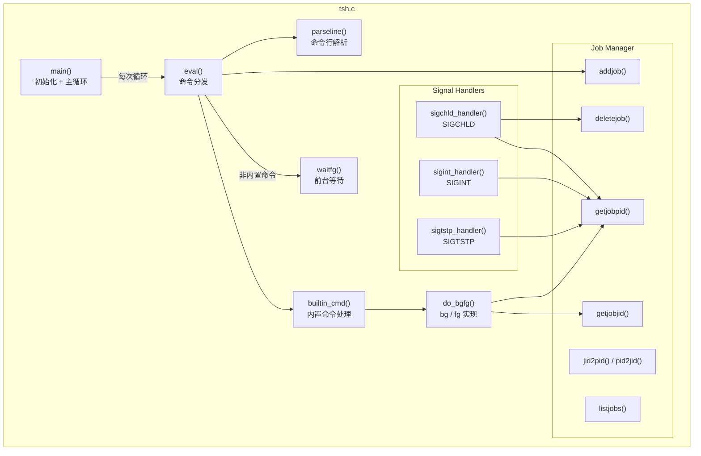
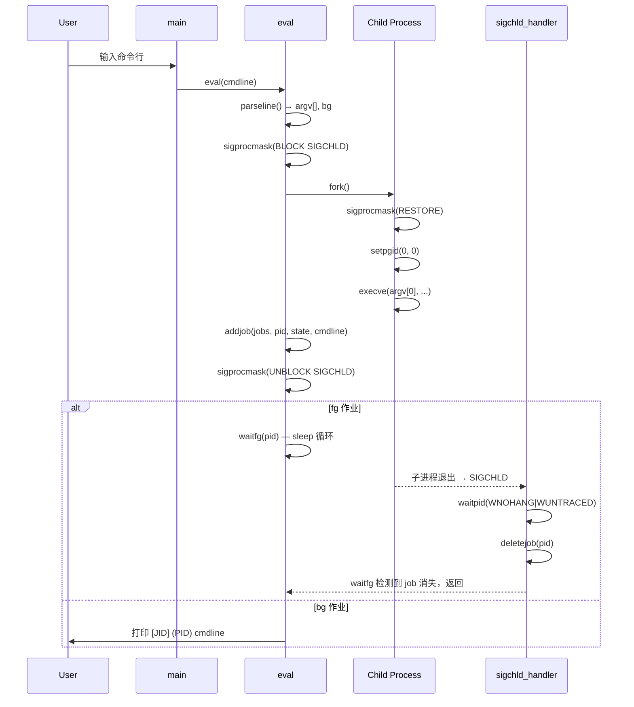
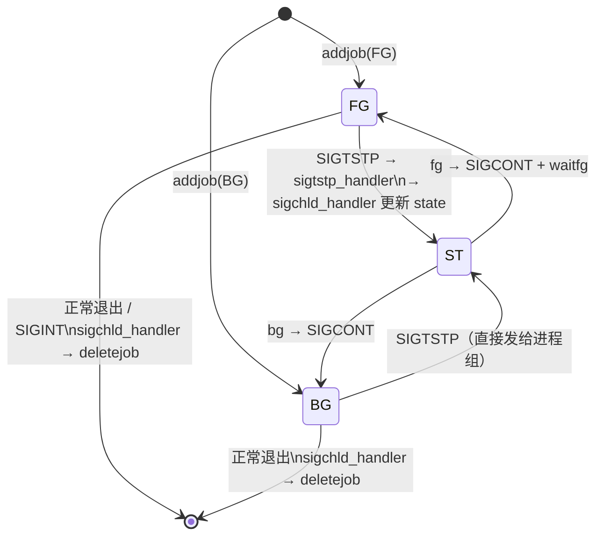

# Design Document

## Overview

Tiny Shell（tsh）是一个运行于 Linux 的简化 Unix shell，使用 C 语言实现。它支持前台与后台作业管理、内置命令（`quit`/`jobs`/`bg`/`fg`）以及 POSIX 信号处理（SIGINT / SIGTSTP / SIGCHLD）。tsh 不支持管道和 I/O 重定向，专注于进程创建、作业控制与信号处理的核心机制。

实现风格遵循 CSAPP Shell Lab 规范：单一 C 源文件（`tsh.c`），静态全局作业数组，以及通过 `sigprocmask` + `fork` + `addjob` 的固定时序防护竞态条件。

### 设计目标

- **正确性**：信号传递给进程组；前台等待通过 `sigchld_handler` 而非 `waitpid` 完成。
- **安全性**：所有信号处理函数只使用 async-signal-safe 函数。
- **无竞态**：`fork` 前屏蔽 SIGCHLD，`addjob` 完成后再解除屏蔽。
- **可测试性**：解析逻辑与作业管理逻辑与 I/O、信号处理保持清晰分离。

---

## Architecture

### 模块划分



### 主循环数据流



---

## Components and Interfaces

### 1. 主循环（`main`）

```c
int main(int argc, char **argv);
```

职责：
- 安装信号处理函数（`signal(SIGINT, sigint_handler)` 等）
- 初始化作业列表（`initjobs(jobs)`）
- 循环：打印 `tsh> `，读取命令行，调用 `eval`，直到 EOF

### 2. 命令求值（`eval`）

```c
void eval(char *cmdline);
```

伪代码：

```
eval(cmdline):
    char *argv[MAXARGS]
    int bg = parseline(cmdline, argv)
    if argv[0] == NULL: return            // 空行

    if builtin_cmd(argv): return          // 内置命令已处理

    sigemptyset(&mask_chld)
    sigaddset(&mask_chld, SIGCHLD)
    sigprocmask(SIG_BLOCK, &mask_chld, &prev)   // 屏蔽 SIGCHLD

    pid = fork()
    if pid == 0:                          // 子进程
        sigprocmask(SIG_SETMASK, &prev, NULL)   // 恢复信号掩码
        setpgid(0, 0)                     // 新进程组
        execve(argv[0], argv, environ)
        fprintf(stderr, "%s: Command not found\n", argv[0])
        exit(1)

    // 父进程
    state = bg ? BG : FG
    addjob(jobs, pid, state, cmdline)
    sigprocmask(SIG_SETMASK, &prev, NULL)        // 解除屏蔽

    if bg:
        printf("[%d] (%d) %s\n", pid2jid(pid), pid, cmdline)
    else:
        waitfg(pid)
```

关键设计决策：`addjob` 必须在解除 SIGCHLD 屏蔽之前完成，保证子进程退出时 `sigchld_handler` 能在作业列表中找到对应条目。

### 3. 命令行解析（`parseline`）

```c
int parseline(const char *cmdline, char **argv);
```

- 将 `cmdline` 按空白（空格、制表符）分割为 `argv[]`，返回 token 数。
- 若最后一个 token 为 `&`，去除它，返回 `1`（后台），否则返回 `0`（前台）。
- `argv` 末尾置 `NULL`。
- 输入超出 MAXLINE / MAXARGS 时打印错误并返回 `-1`。

### 4. 内置命令（`builtin_cmd`）

```c
int builtin_cmd(char **argv);
```

- 匹配 `argv[0]` 为 `"quit"` / `"jobs"` / `"bg"` / `"fg"`。
- 分别调用 `exit(0)` / `listjobs(jobs)` / `do_bgfg(argv)`。
- 返回 `1` 表示已处理，`0` 表示非内置命令。

### 5. bg / fg 实现（`do_bgfg`）

```c
void do_bgfg(char **argv);
```

伪代码：

```
do_bgfg(argv):
    if argv[1] == NULL: 打印缺少参数错误; return

    if argv[1] 以 '%' 开头:
        jid = atoi(argv[1]+1)
        job = getjobjid(jobs, jid)
    else if argv[1] 是纯数字:
        pid = atoi(argv[1])
        job = getjobpid(jobs, pid)
    else:
        打印格式错误; return

    if job == NULL: 打印 not found 错误; return

    kill(-(job->pid), SIGCONT)           // 向进程组发 SIGCONT
    job->state = FG (fg) 或 BG (bg)

    if fg: waitfg(job->pid)
    else:  printf("[%d] (%d) %s\n", ...)
```

### 6. 前台等待（`waitfg`）

```c
void waitfg(pid_t pid);
```

```
waitfg(pid):
    while getjobpid(jobs, pid) != NULL
          && getjobpid(jobs, pid)->state == FG:
        sleep(1)
```

设计约束：**不**调用 `waitpid`；子进程回收和状态转换完全由 `sigchld_handler` 完成。

### 7. SIGCHLD 处理（`sigchld_handler`）

```c
void sigchld_handler(int sig);
```

```
sigchld_handler(sig):
    olderrno = errno
    while (pid = waitpid(-1, &status, WNOHANG|WUNTRACED)) > 0:
        job = getjobpid(jobs, pid)
        if job == NULL: continue          // 未知 PID，忽略

        if WIFEXITED(status):
            deletejob(jobs, pid)

        else if WIFSIGNALED(status):
            printf("Job [%d] (%d) terminated by signal %d\n",
                   job->jid, pid, WTERMSIG(status))
            deletejob(jobs, pid)

        else if WIFSTOPPED(status):
            job->state = ST
            printf("Job [%d] (%d) stopped by signal %d\n",
                   job->jid, pid, WSTOPSIG(status))
    errno = olderrno
```

async-signal-safe 约束：仅使用 `waitpid`、`write`（或已知 async-safe 的 `printf`）、赋值操作。

### 8. SIGINT / SIGTSTP 处理

```c
void sigint_handler(int sig);
void sigtstp_handler(int sig);
```

```
sigint_handler(sig):
    pid = fgpid(jobs)                     // 获取前台作业 PID
    if pid != 0:
        kill(-pid, SIGINT)                // 发送给整个进程组

sigtstp_handler(sig):
    pid = fgpid(jobs)
    if pid != 0:
        kill(-pid, SIGTSTP)
```

---

## Data Models

### `job_t` 结构体

```c
/* 作业状态枚举 */
#define UNDEF 0  /* 未定义（空槽位） */
#define FG    1  /* 前台运行 */
#define BG    2  /* 后台运行 */
#define ST    3  /* 停止（SIGTSTP） */

/* 最大作业数与命令行长度 */
#define MAXJOBS   16
#define MAXLINE   1024
#define MAXARGS   128

typedef struct job_t {
    pid_t pid;              /* 进程 PID（0 表示空槽位） */
    int   jid;              /* 作业号 JID，从 1 开始，不复用 */
    int   state;            /* UNDEF | FG | BG | ST */
    char  cmdline[MAXLINE]; /* 原始命令行（去掉尾部 & 后的副本） */
} job_t;
```

### 全局作业数组

```c
job_t jobs[MAXJOBS];   /* 作业列表，静态分配 */
int   nextjid = 1;     /* 下一个 JID，只增不减 */
```

### 作业管理器 API

| 函数 | 签名 | 说明 |
|------|------|------|
| `initjobs` | `void initjobs(job_t *jobs)` | 清零作业数组 |
| `addjob` | `int addjob(job_t *jobs, pid_t pid, int state, char *cmdline)` | 添加作业，返回 JID；列表满时打印错误返回 0 |
| `deletejob` | `int deletejob(job_t *jobs, pid_t pid)` | 删除指定 PID 的作业，返回 1 成功 / 0 未找到 |
| `getjobpid` | `job_t *getjobpid(job_t *jobs, pid_t pid)` | 按 PID 查找作业 |
| `getjobjid` | `job_t *getjobjid(job_t *jobs, int jid)` | 按 JID 查找作业 |
| `fgpid` | `pid_t fgpid(job_t *jobs)` | 返回前台作业 PID，无则返回 0 |
| `pid2jid` | `int pid2jid(pid_t pid)` | PID 转 JID |
| `jid2pid` | `pid_t jid2pid(int jid)` | JID 转 PID（通过作业列表） |
| `listjobs` | `void listjobs(job_t *jobs)` | 打印所有非 UNDEF 作业 |

### 作业状态机



### 竞态条件防护时序

```
父进程                              子进程
─────────────────────────────────   ──────────────────────────
sigprocmask(BLOCK SIGCHLD)
fork() ─────────────────────────→  // 子进程启动
                                    sigprocmask(RESTORE prev_mask)
                                    setpgid(0, 0)
                                    execve(...)  ← 此时 SIGCHLD 已解除
addjob(jobs, pid, ...)             // 若子进程立即退出...
sigprocmask(RESTORE prev_mask)     // 此时 SIGCHLD 才可能被传递
// sigchld_handler 此时才运行       // 确保 addjob 先于 deletejob
```

关键不变量：**任何时候 `deletejob` 调用必定在 `addjob` 之后**，由 SIGCHLD 屏蔽窗口保证。

---

## Correctness Properties

*属性（Property）是系统在所有合法执行中应保持为真的特征或行为——本质上是关于系统应做什么的形式化陈述。属性在人类可读规范与机器可验证的正确性保证之间架起桥梁。*

> **属性反思（Property Reflection）**：经过对所有验收标准的分析，以下属性已做去冗：
> - 原"bg 标志正确性"与"fg 标志正确性"合并为 Property 1（综合 parseline 行为），因为两者均由 `&` 尾缀决定，合并后覆盖更全面。
> - 原"token 分割正确性"并入 Property 1，避免重复覆盖 `parseline` 逻辑。
> - `listjobs` 完整性（5.1）与格式（5.2）合并为 Property 6，因为格式正确隐含了完整性。

### Property 1: parseline 综合行为正确性

*For any* 合法命令行字符串（仅含可打印 ASCII，长度 ≤ MAXLINE，token 数 ≤ MAXARGS），`parseline` 满足以下所有不变量：argv[0] 等于输入中第一个非空白 token；argv 数组中不含任何纯空白字符串；若原字符串以 `&` 结尾则返回 1 且 argv 中不包含 `&` 作为 token；若不以 `&` 结尾则返回 0。

**Validates: Requirements 1.2, 2.2, 2.3**

### Property 2: parseline 空白行拒绝

*For any* 由纯空格和制表符组成的字符串（包括空字符串），`parseline` 处理后 argv[0] 为 NULL，不产生任何非空 token，表示空命令行。

**Validates: Requirements 1.3**

### Property 3: parseline 超限拒绝

*For any* 长度超过 MAXLINE 字符或 token 数超过 MAXARGS 的命令行字符串，`parseline` 返回错误（-1），不产生有效 argv，且调用方对应的命令不被执行。

**Validates: Requirements 1.6**

### Property 4: 作业列表 JID 唯一性与单调递增

*For any* 合法的 addjob 操作序列（含穿插的 deletejob），作业列表中所有活跃作业的 JID 互不相同，且全局计数器 `nextjid` 严格单调递增，已删除作业的 JID 不会分配给新作业。

**Validates: Requirements 3.1**

### Property 5: addjob 字段存储正确性（round trip）

*For any* 有效的（pid, state, cmdline）三元组，调用 `addjob` 后立即通过 `getjobpid(pid)` 检索，返回的 `job_t` 条目中的 pid、state、cmdline 字段与传入值完全一致。

**Validates: Requirements 3.2**

### Property 6: 双格式作业检索一致性

*For any* 已在作业列表中的作业，通过其 PID 调用 `getjobpid` 与通过其 JID 调用 `getjobjid` 返回的是指向同一 `job_t` 条目的指针（地址相同）。

**Validates: Requirements 3.4**

### Property 7: listjobs 完整性与格式正确性

*For any* 作业列表状态（含 0 至 MAXJOBS 个活跃作业），`listjobs` 输出的行数恰好等于 state ≠ UNDEF 的条目数，且每行均包含该作业的 JID（格式 `[N]`）、PID（格式 `(N)`）、状态字符串（`Running` 或 `Stopped`）和命令行字符串。

**Validates: Requirements 5.1, 5.2**

### Property 8: 停止/恢复状态轮转

*For any* 处于 BG 或 FG 运行状态的作业，将其状态设置为 ST（模拟 SIGTSTP），再通过 `bg`/`fg` 恢复后，作业状态变为 BG 或 FG（Running），即停止再恢复的操作是可逆的状态转换。

**Validates: Requirements 3.7, 6.1, 6.2**

### Property 9: do_bgfg 非法格式参数拒绝

*For any* 既不是纯正整数字符串也不是 `%` 后跟正整数字符串的参数（如字母串、负数、空字符串、特殊字符），`do_bgfg` 打印格式错误消息，不修改作业列表，不向任何进程组发送信号。

**Validates: Requirements 6.4**

---

## Error Handling

### 错误分类与处理策略

| 错误场景 | 处理位置 | 输出目标 | 行为 |
|----------|----------|----------|------|
| 命令行超过 MAXLINE 字符 | `parseline` | stderr | 打印错误，返回 -1；`eval` 检测后重新显示提示符 |
| 参数超过 MAXARGS | `parseline` | stderr | 同上 |
| execve 失败（命令未找到） | 子进程 | stderr | 打印 `%s: Command not found`，`exit(1)` |
| 作业列表已满（MAXJOBS） | `addjob` | stderr | 打印错误，返回 0；父进程检测后不调用 `waitfg` |
| bg/fg 缺少参数 | `do_bgfg` | stdout | 打印 `%s command requires PID or %%jobid argument` |
| bg/fg 参数格式非法 | `do_bgfg` | stdout | 打印 `%s: argument must be a PID or %%jobid` |
| bg/fg 作业不存在 | `do_bgfg` | stdout | 打印 `(%d): No such process` 或 `%%%d: No such job` |
| SIGCHLD 中收到未知 PID | `sigchld_handler` | 无 | 静默忽略（requirements 9.6） |
| 子进程被信号终止 | `sigchld_handler` | stdout | 打印 `Job [%d] (%d) terminated by signal %d`，然后 deletejob |

### 错误传播原则

- 子进程错误（execve 失败）：子进程向 stderr 打印后 `exit(1)`；父进程通过 `sigchld_handler` 感知到子进程非正常退出，打印信号终止消息。
- 系统调用失败（fork/waitpid）：使用 `unix_error()` 包装，向 stderr 打印并 `exit(1)`，视为不可恢复错误。
- 信号处理函数中的错误：必须保存和恢复 `errno`；任何错误输出必须使用 async-signal-safe 函数（如 `write` 而非 `printf`）。

---

## Testing Strategy

### 单元测试（Example-Based）

针对独立的纯函数进行例子驱动的测试：

| 测试目标 | 测试用例示例 |
|----------|-------------|
| `parseline` | `"ls -l"` → `argv=["ls","-l",NULL], bg=0` |
| `parseline` 后台 | `"sleep 10 &"` → `argv=["sleep","10",NULL], bg=1` |
| `parseline` 空行 | `"   "` → `argv[0]=NULL, bg=0` |
| `parseline` 超长 | 1025 字符 → 返回 -1，argv 未修改 |
| `addjob` | 添加 3 个作业，验证 JID 为 1/2/3 |
| `deletejob` | 删除中间作业，验证两端作业不变 |
| `getjobpid` / `getjobjid` | 找到存在的 PID/JID；找不到时返回 NULL |
| `fgpid` | 列表有 FG 作业时返回其 PID；无 FG 时返回 0 |
| `do_bgfg` 参数校验 | `bg`（无参数）、`fg abc`（非法格式）、`fg %99`（不存在 JID） |
| 信号处理器 mock | 使用 `WNOHANG|WUNTRACED` 的 waitpid 循环逻辑（通过函数指针 mock） |

### 属性测试（Property-Based Testing）

使用 [theft](https://github.com/silentbicycle/theft)（C 语言 PBT 库）实现以下属性，每个属性最少运行 **100 次**迭代：

| 属性编号 | 测试函数名 | 标签 |
|----------|-----------|------|
| Property 1 | `prop_parseline_behavior` | `Feature: tiny-shell, Property 1: parseline comprehensive behavior` |
| Property 2 | `prop_parseline_whitespace_reject` | `Feature: tiny-shell, Property 2: parseline whitespace line rejection` |
| Property 3 | `prop_parseline_overlimit_reject` | `Feature: tiny-shell, Property 3: parseline over-limit rejection` |
| Property 4 | `prop_jid_unique_monotonic` | `Feature: tiny-shell, Property 4: JID uniqueness and monotonicity` |
| Property 5 | `prop_addjob_roundtrip` | `Feature: tiny-shell, Property 5: addjob field storage round trip` |
| Property 6 | `prop_job_lookup_consistency` | `Feature: tiny-shell, Property 6: dual format lookup consistency` |
| Property 7 | `prop_listjobs_complete_format` | `Feature: tiny-shell, Property 7: listjobs completeness and format` |
| Property 8 | `prop_stop_resume_roundtrip` | `Feature: tiny-shell, Property 8: stop/resume state round trip` |
| Property 9 | `prop_dobgfg_invalid_format` | `Feature: tiny-shell, Property 9: do_bgfg invalid format rejection` |

**测试组织：**

```
tests/
  unit/
    test_parseline.c
    test_joblist.c
    test_dobgfg.c
  property/
    prop_parseline.c
    prop_joblist.c
  integration/
    test_signals.c      # fork + exec + signal 端到端测试
    test_builtins.c     # 使用 popen/pty 的 shell 集成测试
  Makefile
```

### 集成测试

Shell Lab 提供的 `sdriver.pl` + reference shell `tshref` 对比测试（16 个测试用例）用于集成验收，覆盖：
- 前台/后台作业调度
- `jobs` / `fg` / `bg` 内置命令
- Ctrl-C / Ctrl-Z 信号
- SIGCHLD 僵尸回收
- 混合前后台场景

### 不适用 PBT 的场景

以下场景不使用属性测试：
- 信号传递给进程组（需要 OS 协作，外部行为）：使用集成测试（1-3 个例子）
- execve 失败路径（系统调用副作用）：使用 mock 单元测试
- `waitfg` sleep 循环（纯控制流等待）：使用集成测试验证前台等待语义
- 竞态防护时序（依赖 OS 调度）：使用 `helgrind` / `ThreadSanitizer` 辅助验证
